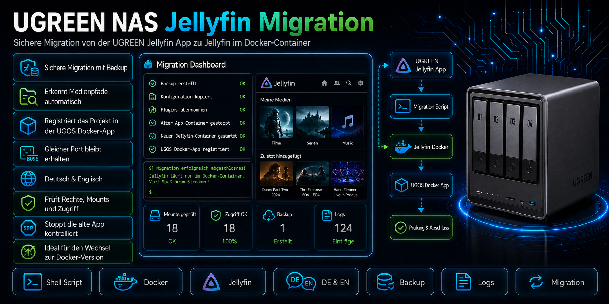
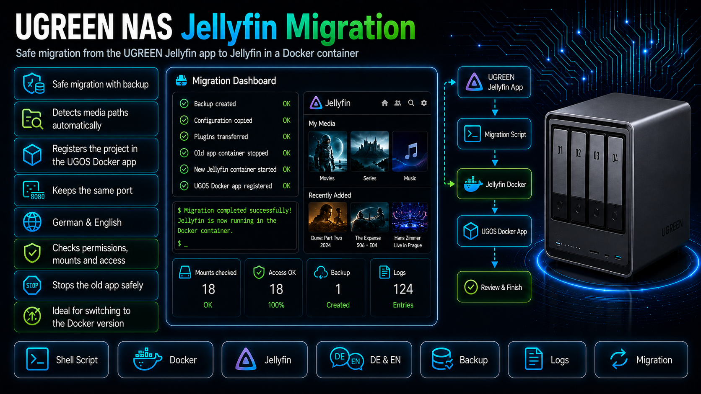

# UGREEN NAS Jellyfin Migration

[](https://github.com/Railsimulatornet/UGREEN-NAS-Jellyfin-Migration/actions/workflows/quality.yml)
[](LICENSE)



[Deutsch](#deutsch) · [English](#english)

## Deutsch

Dieses Paket überträgt eine bestehende Jellyfin-Installation aus dem UGREEN App Center in ein normales Docker-Projekt. Es übernimmt Konfiguration, Plugins und Medienpfade und unterstützt den weiteren Betrieb über die UGOS-Docker-App.

Bei der normalen Migration wird die alte App vor dem Backup und Kopieren gestoppt. Das Skript prüft den Stillstand, erstellt das neue Projekt und zeigt anschließend URL, Backup-Pfad und nächste Schritte an.

### Funktionen

- Automatische Erkennung der alten UGREEN-Jellyfin-App und ihrer Medien-Mounts.
- Sicherung der vorhandenen Konfiguration, Plugins und des Caches.
- Neues Compose- und UGOS-Projekt namens `jellyfin-docker`.
- Automatische Ermittlung der Benutzer- und Gruppenwerte für einen neuen Container ohne Root-Benutzer.
- Übernahme des bisherigen HTTP-Ports und erkannter Hardwaregeräte, beispielsweise `/dev/dri`.
- Zugriffstests für Medien, Mounts, `/config` und `/cache`.
- Optionale Registrierung und Aktualisierung in der UGOS-Docker-App.
- Deutsche und englische Skriptausgabe sowie ein ausführliches DE/EN-Handbuch.
- Die alte App bleibt bei den Standardeinstellungen installiert und kann nach der Prüfung manuell entfernt werden.

### Voraussetzungen

- UGREEN NAS mit UGOS und einer vorhandenen Jellyfin-Installation aus dem App Center.
- Aktivierter SSH-Zugang und Root-Rechte.
- Docker, Docker Compose beziehungsweise `docker-compose`, Python 3 und `tar`.
- Zugriff auf das benötigte Jellyfin-Image.
- Ausreichend freier Speicher für Backup und neue Konfigurationskopie.

Bisher im Projekt getestet auf: **DXP4800PRO**.

### Schnellstart

1. Lade das aktuelle Paket unter [Releases](https://github.com/Railsimulatornet/UGREEN-NAS-Jellyfin-Migration/releases/latest) herunter.
2. Entpacke das ZIP und kopiere den Ordner `UGREEN-NAS-Jellyfin-Migration-v1.0.1` auf das NAS, zum Beispiel per SMB nach `/volume1/docker/`.
3. Aktiviere SSH in UGOS und verbinde dich mit PuTTY oder einem anderen SSH-Client.
4. Wechsle zu Root und bereite den Skriptstart vor:

```bash
sudo -i
cd /volume1/docker/UGREEN-NAS-Jellyfin-Migration-v1.0.1
chmod +x start.sh
```

5. Führe zuerst die Erkennungs- und Zugriffsprüfung aus:

```bash
./start.sh --check-only
```

6. Prüfe die angezeigten Pfade, Medien-Mounts, Benutzerwerte und den Port. Starte danach die Migration:

```bash
./start.sh
```

7. Öffne nach Abschluss die vom Skript angezeigte Jellyfin-URL. Bei einem übernommenen Port `8899` lautet sie zum Beispiel `http://<NAS-IP>:8899`.

Die Pfade und der Port sind Beispiele. Das Skript übernimmt standardmäßig den Port der alten App und versucht, die passende NAS-IP anzuzeigen.

### Konfiguration und Modi

Die Datei [.env](UGREEN-NAS-Jellyfin-Migration-v1.0.1/.env) enthält vorbereitete Standardwerte. Für die normale Migration muss sie meist nicht geändert werden. Prüfe Änderungen anhand der Kommentare und der erkannten Umgebung.

| Modus | Verhalten |
| --- | --- |
| `CHECK_ONLY` / `--check-only` | Umgebung, Erkennung und Zugriff prüfen; keine Migration ausführen. |
| `BACKUP_ONLY` / `--backup-only` | Backup erstellen, während die alte App aktiv bleibt. |
| `SAFE_MIGRATION` / `--safe-migration` | Alte App stoppen und Stillstand prüfen, Backup und Konfigurationskopie erstellen, neues Projekt starten. Standardmodus. |
| `FULL_MIGRATION` / `--full-migration` | Wie die normale Migration; zusätzlich kann der alte Docker-Container nach ausdrücklicher Freigabe entfernt werden. Die App-Center-Deinstallation bleibt ein eigener Schritt. |

`SAFE_MIGRATION` und `FULL_MIGRATION` prüfen den Stillstand vor dem Kopieren der Datenbanken. Bei einem Fehler vor dem erfolgreichen Start des neuen Containers versucht das Skript, die ursprüngliche Restart-Policy und den vorherigen Laufzustand der alten App wiederherzustellen. Ein bereits laufender neuer Container verhindert einen konkurrierenden Neustart der alten App.

**`BACKUP_ONLY` kopiert die laufende App und bietet diese Stillstandsprüfung nicht.**

| Einstellung | Bedeutung |
| --- | --- |
| `LANGUAGE` | `de` oder `en` für die Skriptausgabe. |
| `MIGRATION_MODE` | Standard: `SAFE_MIGRATION`. |
| `DOCKER_PROJECT_PATH=auto` | Ziel normalerweise `/volumeX/docker/JellyfinDocker`. |
| `BACKUP_PATH=auto` | Backups normalerweise unter `/volumeX/docker/Jellyfin-Migration-Backup`. |
| `MEDIA_MOUNT_MODE=rw` | Erlaubt Jellyfin das Schreiben von NFO-Dateien und Postern neben den Medien. Mit `ro` ist dies gesperrt. |
| `JELLYFIN_PORT_HTTP=auto` | Bisherigen Host-Port übernehmen. |
| `JELLYFIN_IMAGE` | Vorgabe: `jellyfin/jellyfin:latest`. |
| `JELLYFIN_CONTAINER_NAME`, `COMPOSE_PROJECT_NAME`, `UGOS_PROJECT_NAME` | Standardmäßig jeweils `jellyfin-docker`. |
| `JELLYFIN_USER`, `JELLYFIN_UID`, `JELLYFIN_GID`, `JELLYFIN_GROUPS` | Standardmäßig automatische Ermittlung des Benutzers und seiner Gruppen. |
| `ENABLE_HARDWARE_ACCEL=auto` | Erkannte Hardwaregeräte aus dem alten Container berücksichtigen. |
| `CACHE_MIGRATE=false` | Cache sichern, aber für den neuen Container standardmäßig einen frischen Cache verwenden. |
| `REGISTER_UGOS_PROJECT=ask`, `REFRESH_UGOS_DOCKER_APP=ask` | Vor Registrierung und Aktualisierung der Docker-App nachfragen. Die Datenbank wird vor dem Ändern gesichert. |
| `STOP_UGREEN_APP=true` | Alte App für die Migration stoppen; ihre Restart-Policy wird auf `no` gesetzt. |
| `REMOVE_UGREEN_APP=false` | Alten Docker-Container nicht automatisch entfernen. Eine Entfernung im erweiterten Modus benötigt zusätzliche Freigaben. |
| `ROOT_METADATA_SCAN=true` | Root-eigene Metadaten erkennen und im Bericht aufführen. |
| `INTERACTIVE=true` | Interaktive Rückfragen aktivieren. |
| `TZ=Europe/Berlin` | Zeitzone des neuen Containers. |

### Ablauf der Migration

1. Sprache wählen, Rechte und benötigte Programme prüfen.
2. Alte App, Medienpfade, UID/GID und zusätzliche Gruppen erkennen.
3. Den Medienzugriff in einem Testcontainer prüfen.
4. Alte App stoppen, Restart-Policy anpassen und den Stillstand prüfen.
5. Backup der alten Jellyfin-Daten erstellen.
6. Das neue Docker-Projekt vorbereiten, Konfiguration und Plugins übernehmen und Compose erzeugen.
7. Neuen Container starten und je nach Auswahl in der UGOS-Docker-App registrieren; nach einer Aktualisierung der Docker-App den Stillstand der alten App erneut prüfen.
8. Medienzugriff und Containerzustand prüfen und den Abschlussbericht mit URL, Backup und Log anzeigen.

### Nach der Migration

Prüfe in Jellyfin:

- Anmeldung und vorhandene Benutzer.
- Bibliotheken und Medienpfade.
- Plugins.
- Wiedergabe und, falls verwendet, Transcoding.

Falls Jellyfin Plugin-Aktualisierungen meldet, starte den neuen Jellyfin-Container anschließend einmal neu.

Wenn alles funktioniert, kannst du die alte App über **UGREEN App Center → Jellyfin → Deinstallieren** entfernen. Behalte den neuen Projektordner `/volumeX/docker/JellyfinDocker`, das Projekt `jellyfin-docker` und zunächst auch die Backups.

Das Migrationstool wird nicht für den dauerhaften Betrieb benötigt. Weitere Jellyfin-Aktualisierungen erfolgen über das erzeugte Docker-Projekt.

### Hinweise und Fehlersuche

| Thema | Einordnung |
| --- | --- |
| Directory-Watcher-Warnung | Wenn der tatsächliche Zugriffstest erfolgreich ist, betrifft die Warnung gewöhnlich die Echtzeitüberwachung. Normale Bibliotheksscans und Wiedergabe können weiterhin funktionieren. Prüfe beides nach der Migration. |
| Root-eigene NFO-Dateien oder Poster | Das Skript erkennt diese Dateien und prüft den Zugriff. Bei erfolgreichem Zugriff werden keine Medienrechte automatisch verändert. |
| Cache und Transcodes | Der Cache wird gesichert; `/cache/transcodes` wird als temporärer Inhalt übersprungen. Mit `CACHE_MIGRATE=false` startet der neue Container mit frischem Cache. |
| Abweichender Port oder Pfad | Verwende die tatsächlich erkannten Werte aus Prüflauf und Abschlussbericht. `8899` und die gezeigten Volume-Pfade sind Beispiele. |
| Alte Testmigration vorhanden | Das Skript kann vorhandene Testprojekte erkennen und zum Stoppen beziehungsweise Umbenennen nachfragen. Prüfe die angegebenen Projekte vor der Bestätigung. |

### Projektstruktur und Dokumentation

| Pfad | Inhalt |
| --- | --- |
| [UGREEN-NAS-Jellyfin-Migration-v1.0.1/](UGREEN-NAS-Jellyfin-Migration-v1.0.1/) | `start.sh`, `.env`, `LICENSE` und `VERSION`. |
| [Screens/](Screens/) | Deutsche und englische Projektbilder. |
| [UGREEN-NAS-Jellyfin-Migration_Handbuch_DE-EN.pdf](UGREEN-NAS-Jellyfin-Migration_Handbuch_DE-EN.pdf) | Ausführliche Schrittfolge für UGOS, SSH/PuTTY, SMB, Prüfung, Migration und Deinstallation der alten App. |

Aktuelle Tool-Version: **v1.0.1**. Das [Release](https://github.com/Railsimulatornet/UGREEN-NAS-Jellyfin-Migration/releases/latest) enthält ZIP-Paket und PDF-Handbuch.

### Lizenz

Dieses Projekt steht unter der [MIT-Lizenz](LICENSE).

Copyright © 2026 **Roman Glos / Railsimulatornet**. Community-Lösung, kein offizielles UGREEN-Produkt. Verwendung auf eigene Verantwortung.

## English



This package transfers an existing Jellyfin installation from the UGREEN App Center into a regular Docker project. It carries over configuration, plugins and media paths and supports continued operation through the UGOS Docker app.

During normal migration, the old app is stopped before backup and copying. The script verifies that it has stopped, creates the new project and then displays the URL, backup path and next steps.

### Features

- Automatic detection of the old UGREEN Jellyfin app and its media mounts.
- Backup of existing configuration, plugins and cache.
- A new Compose and UGOS project named `jellyfin-docker`.
- Automatic user and group detection for a new container running without the root user.
- Retention of the existing HTTP port and detected hardware devices, such as `/dev/dri`.
- Access checks for media, mounts, `/config` and `/cache`.
- Optional registration and refresh in the UGOS Docker app.
- German and English script output and a detailed DE/EN manual.
- With default settings, the old app stays installed and can be removed manually after verification.

### Requirements

- UGREEN NAS running UGOS with an existing Jellyfin installation from the App Center.
- Enabled SSH access and root privileges.
- Docker, Docker Compose or `docker-compose`, Python 3 and `tar`.
- Access to the required Jellyfin image.
- Enough free space for the backup and the new configuration copy.

Previously tested in this project on: **DXP4800PRO**.

### Quick start

1. Download the current package from [Releases](https://github.com/Railsimulatornet/UGREEN-NAS-Jellyfin-Migration/releases/latest).
2. Extract the ZIP and copy `UGREEN-NAS-Jellyfin-Migration-v1.0.1` to the NAS, for example through SMB into `/volume1/docker/`.
3. Enable SSH in UGOS and connect using PuTTY or another SSH client.
4. Become root and prepare the script:

```bash
sudo -i
cd /volume1/docker/UGREEN-NAS-Jellyfin-Migration-v1.0.1
chmod +x start.sh
```

5. Run detection and access checks first:

```bash
./start.sh --check-only
```

6. Review the displayed paths, media mounts, user settings and port. Then start migration:

```bash
./start.sh
```

7. Open the Jellyfin URL shown by the script after completion. If the inherited port is `8899`, it will look like `http://<NAS-IP>:8899`.

The paths and port are examples. By default, the script reuses the old app's port and attempts to display the appropriate NAS IP.

### Configuration and modes

The [.env](UGREEN-NAS-Jellyfin-Migration-v1.0.1/.env) file contains prepared defaults. Normal migration usually does not require changes. Review any adjustments against the comments and your detected environment.

| Mode | Behavior |
| --- | --- |
| `CHECK_ONLY` / `--check-only` | Check the environment, detection and access; do not perform migration. |
| `BACKUP_ONLY` / `--backup-only` | Create a backup while the old app remains active. |
| `SAFE_MIGRATION` / `--safe-migration` | Stop the old app and verify it is stopped, create the backup and configuration copy, then start the new project. Default mode. |
| `FULL_MIGRATION` / `--full-migration` | As normal migration, with optional removal of the old Docker container after explicit confirmation. Uninstallation through the App Center remains a separate step. |

`SAFE_MIGRATION` and `FULL_MIGRATION` verify that the old app is stopped before copying databases. If a failure occurs before the new container starts successfully, the script attempts to restore the old restart policy and previous running state. An already running new container prevents a conflicting restart of the old app.

**`BACKUP_ONLY` copies the running app and does not provide this stopped-state check.**

| Setting | Meaning |
| --- | --- |
| `LANGUAGE` | `de` or `en` for script output. |
| `MIGRATION_MODE` | Default: `SAFE_MIGRATION`. |
| `DOCKER_PROJECT_PATH=auto` | Destination normally at `/volumeX/docker/JellyfinDocker`. |
| `BACKUP_PATH=auto` | Backups normally under `/volumeX/docker/Jellyfin-Migration-Backup`. |
| `MEDIA_MOUNT_MODE=rw` | Allows Jellyfin to write NFO files and posters beside media. `ro` prevents this. |
| `JELLYFIN_PORT_HTTP=auto` | Reuse the existing host port. |
| `JELLYFIN_IMAGE` | Default: `jellyfin/jellyfin:latest`. |
| `JELLYFIN_CONTAINER_NAME`, `COMPOSE_PROJECT_NAME`, `UGOS_PROJECT_NAME` | All default to `jellyfin-docker`. |
| `JELLYFIN_USER`, `JELLYFIN_UID`, `JELLYFIN_GID`, `JELLYFIN_GROUPS` | Automatically determine the user and groups by default. |
| `ENABLE_HARDWARE_ACCEL=auto` | Include detected hardware devices from the old container. |
| `CACHE_MIGRATE=false` | Back up the cache, but use a fresh cache for the new container by default. |
| `REGISTER_UGOS_PROJECT=ask`, `REFRESH_UGOS_DOCKER_APP=ask` | Ask before project registration and Docker app refresh. The database is backed up before modification. |
| `STOP_UGREEN_APP=true` | Stop the old app for migration; set its restart policy to `no`. |
| `REMOVE_UGREEN_APP=false` | Do not automatically remove the old Docker container. Removal in the advanced mode requires additional confirmations. |
| `ROOT_METADATA_SCAN=true` | Detect root-owned metadata and include it in the report. |
| `INTERACTIVE=true` | Enable interactive prompts. |
| `TZ=Europe/Berlin` | Time zone of the new container. |

### Migration sequence

1. Select the language and check privileges and required programs.
2. Detect the old app, media paths, UID/GID and supplementary groups.
3. Check media access in a test container.
4. Stop the old app, adjust its restart policy and verify that it has stopped.
5. Back up the old Jellyfin data.
6. Prepare the new Docker project, transfer configuration and plugins, and generate Compose.
7. Start the new container and register it in the UGOS Docker app if selected; after a Docker app refresh, verify again that the old app is stopped.
8. Check media access and container status, then show the final report with URL, backup and log paths.

### After migration

Check in Jellyfin:

- Login and existing users.
- Libraries and media paths.
- Plugins.
- Playback and, if used, transcoding.

If Jellyfin reports plugin updates, restart the new Jellyfin container once afterwards.

Once everything works, you can remove the old app through **UGREEN App Center → Jellyfin → Uninstall**. Keep the new `/volumeX/docker/JellyfinDocker` directory, the `jellyfin-docker` project and, for now, the backups.

The migration tool is not required for normal ongoing operation. Further Jellyfin updates are handled through the generated Docker project.

### Notes and troubleshooting

| Topic | Explanation |
| --- | --- |
| Directory-watcher warning | If the actual access test succeeds, the warning usually concerns real-time monitoring. Normal library scans and playback may still work. Verify both after migration. |
| Root-owned NFO files or posters | The script detects these files and checks access. When access succeeds, media permissions are not changed automatically. |
| Cache and transcodes | The cache is backed up; `/cache/transcodes` is excluded as temporary content. With `CACHE_MIGRATE=false`, the new container starts with a fresh cache. |
| Different port or path | Use the actual values shown by the check run and final report. `8899` and the illustrated volume paths are examples. |
| Existing test migration | The script can detect existing test projects and ask to stop or rename them. Check the named projects before confirming. |

### Project structure and documentation

| Path | Contents |
| --- | --- |
| [UGREEN-NAS-Jellyfin-Migration-v1.0.1/](UGREEN-NAS-Jellyfin-Migration-v1.0.1/) | `start.sh`, `.env`, `LICENSE` and `VERSION`. |
| [Screens/](Screens/) | German and English project images. |
| [UGREEN-NAS-Jellyfin-Migration_Handbuch_DE-EN.pdf](UGREEN-NAS-Jellyfin-Migration_Handbuch_DE-EN.pdf) | Detailed UGOS, SSH/PuTTY, SMB, verification, migration and old-app uninstallation steps. |

Current tool version: **v1.0.1**. The [release](https://github.com/Railsimulatornet/UGREEN-NAS-Jellyfin-Migration/releases/latest) includes the ZIP package and PDF manual.

### License

This project is licensed under the [MIT License](LICENSE).

Copyright © 2026 **Roman Glos / Railsimulatornet**. Community solution, not an official UGREEN product. Use at your own risk.

